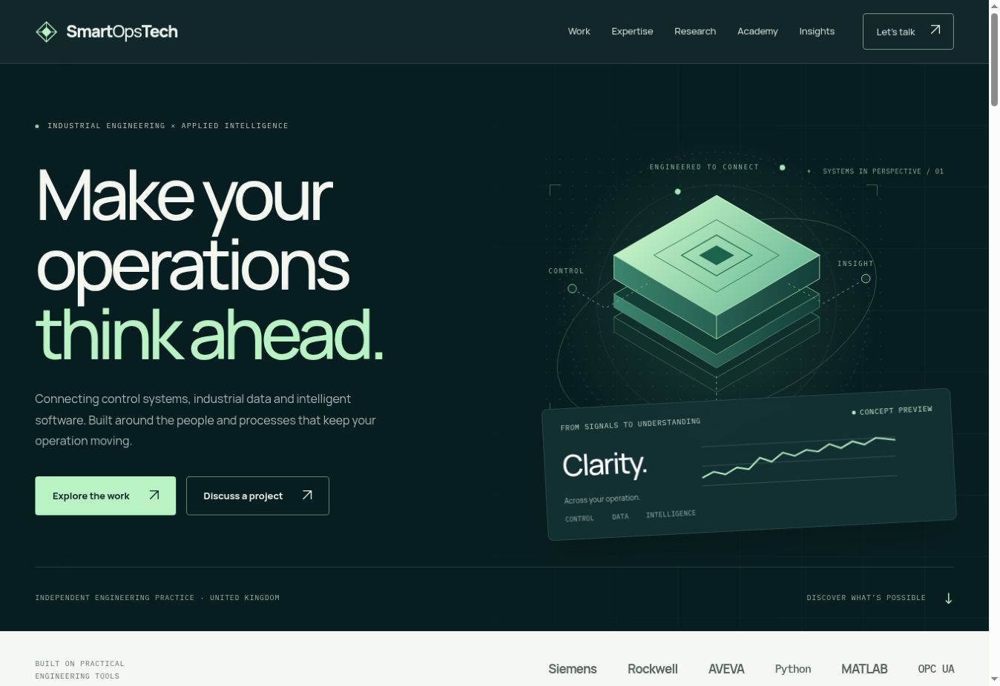

# SmartOpsTech redesign review

Prepared 5 November 2026 for review. Production has not been replaced.

## Why this change

The public site loaded successfully during the audit. Vercel's public domain configuration reported `misconfigured: false`. Private project administration was separately blocked by the Vercel connection's team grant; this did not establish a public-site outage.

The existing site had several concrete presentation and content issues:

- More than 30 project summaries on the homepage without linked detail pages.
- A counter script that defaulted to a percent suffix, including for a count of failures averted.
- Project performance, financial and certification claims without supporting links on the page. Their accuracy was not independently established.
- Research listings without direct source links, and future blog entries that did not lead to articles.
- A basic email link with little help for a visitor describing an enquiry.

## What changes

- A teal and mint visual identity, vector engineering artwork, responsive layouts and consistent navigation across 13 pages, including the 404 page.
- A focused portfolio with four linked project walkthroughs, category filters and public source-code links.
- A browser-local demonstration with production, maintenance and batch scenarios. All values and charts are labelled as illustrative simulated data.
- A research page linking to Juliet's neural network assisted MPC preprint on ResearchGate.
- Academy enquiry pathways, a complete engineering article and a validated local email draft builder.
- Shared templates, local WOFF fonts, semantic page headings, keyboard focus styles, a skip link, reduced-motion support, canonical links, social metadata, robots.txt and a sitemap.
- Matching favicon and social sharing artwork.

The selection of projects, learning themes and revised claims is an editorial proposal for the owner's review. Existing production content remains in Git history. Additional verified project results, photographs, credentials and approved client case studies can be added once supplied.

## Verification

- Generated all 13 pages successfully; JavaScript syntax check passed.
- Checked local page and asset references, internal anchors, unique element IDs, single H1 headings and JSON-LD parsing.
- Visually inspected the desktop homepage and a narrow-screen layout.
- Confirmed no horizontal document overflow in the tested 375 px homepage and 753 px contact layout widths.
- Opened the mobile navigation and followed Work successfully.
- Selected the Automation filter and verified the two matching project cards.
- Exercised the simulated maintenance and batch views and confirmed that the labels, values and explanatory text changed.
- Confirmed that required contact fields reject an empty submission and that valid sample details produce the expected local email draft. No email was sent.
- Fonts compressed from 740,580 bytes to 315,836 bytes before transport compression.

These checks do not constitute a full accessibility audit, cross-browser certification or a measured Lighthouse/Core Web Vitals result.

## Publication and operational limits

The form does not deliver email from a server. The visitor must send through their email app or copy the draft. There is no booking, checkout, course enrolment or live industrial data service.

Review the preview and editorial changes before merging. The current Vercel team access grant must be approved to inspect private settings or manage deployment through the connected app. Keep the existing production domain and hosting project.
